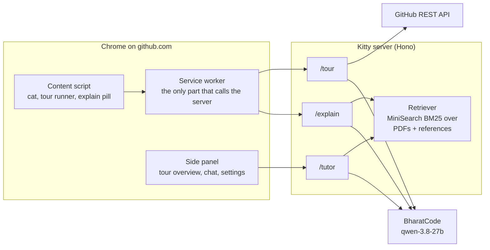

<div align="center">

# 🐙 Git × GitHub — Cheat Sheet & Scenario Guide

> Everything you need to go from **zero to confident** with Git & GitHub  
> Cheat sheets · Illustrated PDFs · Real-world scenarios · Basic → Advanced

[](https://github.com/Krish6115/GitxGithub/stargazers)
[](https://github.com/Krish6115/GitxGithub/forks)
[](LICENSE)
[](https://github.com/Krish6115/GitxGithub/pulls)

</div>

---

## 📌 Why This Repo?

Most Git tutorials either drown you in theory or show you 3 commands and call it a day.  
This repo takes a **scenario-first approach** — real situations, exact commands, and explanations of *why* each one works.

Whether you're:
- 🆕 Pushing your first file to GitHub
- 🤝 Collaborating on a team project
- 🔥 Recovering from a bad `git reset`
- 🚀 Tagging releases and working with PRs

...this repo has you covered.

---

## 📂 What's Inside
```
GitxGithub/
├── 📁 Git/
│   ├── 📄 Git_GitHub_101.pdf          ← Basics: CLI, branching, forking, stash, rebase
│   ├── 📄 Git_Github Notes.pdf        ← Workflow notes & command reference  
│   ├── 📄 git-cheat-sheet-education.pdf ← Official GitHub cheat sheet
│   ├── 📄 git_missing_topics(other than 101,notes,cheatsheet).pdf ←Other than the above 3 pdfs covers everything
│   └── 📁 references/                 ← Openly licensed deep dives (Pro Git, GitHub Docs, git docs)
├── 📁 Scenario-Based_Guide/
│   ├── 📄 git_scenarios.pdf  ← Loaded with Real Word Scenarios for better understanding
│   └── 📁 references/                 ← Scenario-style references (PR updates, conflicts, leaked secrets…)
├── 📁 kitty/                          ← 🐾 Kitty, the Git & GitHub companion (Chrome extension + server)
├── 📄 BharatCode.txt                  ← How Kitty uses BharatCode
└── 📄 README.md                       ← You're here
```
---

## 🐾 Meet Kitty — your Git & GitHub companion

Kitty is a small pixel cat that lives on **github.com** (a Chrome extension) and turns this repo's learning material into help you can use while you work.

<div align="center">
  
</div>

| | What it does |
|---|---|
| 🗺️ **Tour this repo** | Click the cat on any repository. Kitty picks the key files, then walks you through them one by one, highlighting each file with a short "what it is / why it matters". Understand a codebase *before* you hand it to an AI. |
| 💬 **Ask Kitty** | A chat in the side panel. Answers are scenario-first (Situation → Commands → Why → How to undo) and cite their sources: these PDFs, Pro Git, GitHub Docs and the git docs. |
| 🔍 **Explain this** | Select a command, a diff, PR text or code on GitHub (or right-click it) for a short explanation. Commands get a risk label: *Safe*, *Rewrites history* or *Can lose work*. |

### Install

1. Download `kitty-extension-v0.1.0.zip` from the [latest release](https://github.com/Krish6115/GitxGithub/releases/latest) and unzip it.
2. In Chrome open `chrome://extensions`, turn on **Developer mode**, click **Load unpacked** and pick the unzipped folder.
3. The welcome screen opens: check the server connection, optionally add your own BharatCode key, and you're ready. Open any repo on GitHub and click the cat.

### Run your own server

```bash
cd kitty
npm ci
cp server/.env.example server/.env   # add BHARATCODE_API_KEY (and optionally GITHUB_TOKEN)
npm run dev -w server                # http://localhost:8787 — uses a mock model until LLM_PROVIDER=bharatcode
npm run build -w extension           # then load kitty/extension/dist as an unpacked extension
```

The release build talks to the hosted server at `https://kitty-server.vercel.app`. To host your own on Vercel: root directory `kitty/server`, framework Hono, install command `cd .. && npm ci -w server --include-workspace-root`, and set `LLM_PROVIDER=bharatcode` plus `BHARATCODE_API_KEY`. Then point the extension at it in **Settings**, or build the zip with `VITE_KITTY_SERVER_URL=<your url> npm run package -w extension`.

### How it works



- **Grounded answers:** the PDFs and `*/references/` are chunked into a prebuilt index (`kitty/server/data/index.json`); the tutor retrieves the best chunks and must cite them. A retrieval eval keeps search quality at ≥ 85% hit@6 (currently 27/27).
- **Safe by design:** API keys never ship in the extension. Repository and page text is treated as untrusted data, so a README that tries to instruct the model is ignored. Answers stream with first-token, idle and total timeouts and retry on transient failures.
- **Tested:** 160+ unit tests (network disabled), browser e2e suites for every feature, and live checks against the real model. See [`kitty/ingest/README.md`](kitty/ingest/README.md) and [`kitty/extension/e2e/README.md`](kitty/extension/e2e/README.md).

### Cost per request (BharatCode tokens, measured on the live model)

| Feature | Typical tokens | Typical time |
|---|---|---|
| Repo tour | 5k (small repo) – 25k (Linux kernel) | 30–40 s |
| Tutor answer | ~3.3k (1.4k–4.4k) | first words in 3–8 s, done in 6–20 s |
| Explain this | ~0.8k (0.5k–1.5k) | 5–14 s |

Tours are cached per repository commit, so a second tour of the same repo costs nothing.

### Credits

Kitty's knowledge comes from this repo's PDFs plus adapted excerpts from [*Pro Git*](https://git-scm.com/book) by Scott Chacon and Ben Straub ([CC BY-NC-SA 3.0](https://creativecommons.org/licenses/by-nc-sa/3.0/)), [GitHub Docs](https://github.com/github/docs) ([CC BY 4.0](https://creativecommons.org/licenses/by/4.0/)) and the [Git documentation](https://git-scm.com/docs) ([GPL-2.0](https://github.com/git/git/blob/master/COPYING)). Every excerpt is attributed in [`Git/references/SOURCES.md`](Git/references/SOURCES.md); those files keep their own licenses and are not covered by this repo's MIT license. The cat is an original pixel design.

---

## 📘 What Each Resource Covers

### 🔰 1. Git & GitHub 101
- Basics of Git CLI
- init, clone, add, commit, push
- Branching, merging, PRs

---

### 🎯 2. Scenario-Based Guide
📄 `git_scenarios.pdf`

Learn Git like a real developer:

- First-time setup  
- Uploading code  
- Branching & merging  
- Fork & PR workflow  
- Merge conflicts  
- Undoing mistakes  
- Team workflows  
- Releases & tagging  
- Advanced debugging  

💡 Based on real-world developer situations  
👉 This replaces traditional boring tutorials  

---

### 🧠 3. Advanced Topics 
📄 `git_missing_topics.pdf`

Covers what most tutorials **don’t teach**:

- `git reflog` (recover anything)
- `git cherry-pick`
- `git bisect` (debug faster)
- `git blame`
- `git commit --amend`
- GitHub CLI (`gh`)
- SSH & Authentication
- Advanced `.gitignore`

---

### 📄 4. GitHub Cheat Sheet
- Quick command reference
- Perfect for revision

---
---

## 📋 10 Real-World Scenarios Covered

| # | Scenario | What You'll Learn |
|---|----------|-------------------|
| 01 | **First-Time Setup** | git config, SSH keys, no-password auth |
| 02 | **Upload Your First File** | clone → add → commit → push |
| 03 | **Working with Branches** | feature branches, merge, cleanup |
| 04 | **Contributing via Fork** | fork, upstream remote, pull requests |
| 05 | **Handling Merge Conflicts** | conflict markers, manual resolve |
| 06 | **Undoing Mistakes** | restore, reset, revert — matched to situation |
| 07 | **Keeping Fork in Sync** | fetch, rebase, reset --hard upstream |
| 08 | **Team Feature Branch Workflow** | squash commits, PR review, protect main |
| 09 | **Tagging & Releasing Versions** | annotated tags, GitHub Releases, semver |
| 10 | **Cherry-pick & Bisect** | apply one commit anywhere, binary-search bugs |

---
---

## 🚀 Quick Start — The Everyday Loop

> **New to Git?** Run these 4 commands. That's it.
```bash
# 1️⃣  One-time setup (first time on any machine)
git config --global user.name "YourName"
git config --global user.email "you@example.com"

# 2️⃣  Clone the repo once
git clone https://github.com/YourUsername/YourRepo.git
cd YourRepo

# 3️⃣  Stage → Commit → Push  (repeat for every change)
git add path/to/YourFile.java
git commit -m "Add InsertLinkedList.java to LinkedList folder"
git push origin main
```
> 🔥 **If push is rejected** (someone else pushed first):
> ```bash
> git pull origin main --rebase
> git push origin main
> ```
---

## 🧠 The Commands You Actually Need to Know
```bash
# ── Daily workflow ────────────────────────────────────────────
git status                        # what's changed?
git add .                         # stage everything
git commit -m "feat: your msg"    # commit
git push                          # push

# ── Branches ─────────────────────────────────────────────────
git checkout -b feature/my-thing  # create + switch
git checkout main                 # go back to main
git merge feature/my-thing        # merge in

# ── Oops recovery ────────────────────────────────────────────
git restore filename.txt          # undo unsaved edits
git restore --staged filename.txt # unstage a file
git reset HEAD~1 --soft           # undo last commit, keep changes
git revert abc1234                # safely undo a pushed commit

# ── Inspect ──────────────────────────────────────────────────
git log --oneline --graph --all   # visual branch history
git diff                          # what changed (unstaged)
git blame filename.js             # who wrote each line
git reflog                        # full history — recover anything
```

---

## 🤝 Contributing

Contributions are welcome! Found a missing scenario? A cleaner explanation?
```bash
# 1. Fork this repo (click Fork button above)
# 2. Clone your fork
git clone https://github.com/YOUR_USERNAME/GitxGithub.git

# 3. Create a branch
git checkout -b improve/scenario-name

# 4. Make your changes, commit
git add .
git commit -m "Add: scenario for GitHub Actions workflow"

# 5. Push and open a Pull Request
git push origin improve/scenario-name
```

Then open a Pull Request from your fork → this repo's `main`.

**Good first contributions:**
- 📝 Fix a typo or unclear explanation
- ➕ Add a missing command or scenario
- 🌍 Add examples for Windows (most examples use Mac/Linux)
- 🖼 Improve illustrations or diagrams in the PDFs

---

## 🌟 Share This Repo

If this helped you, consider:

- ⭐ **Starring** the repo (top right of this page)
- 🍴 **Forking** it to build your own version
- 📢 **Sharing** in your dev community, discord, or college group

> *Every star helps more developers find this resource.*

---

## 📬 Connect

Made by **[Krish6115](https://github.com/Krish6115)** — CS undergraduate, Full-Stack developer, competitive programmer & AI/ML Enthusiast.

Feel free to open an [issue](https://github.com/Krish6115/GitxGithub/issues) if something's unclear or missing.

---

<div align="center">

**⭐ Star · 🍴 Fork · 📢 Share**

*Built for developers who want to understand Git, not just memorize commands.*

</div>
