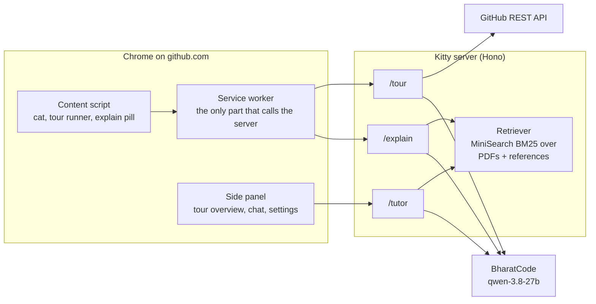

# 🐾 Kitty — your Git & GitHub companion

Kitty is a pixel cat that lives on **github.com** (Chrome extension) and turns GitKitty's learning material into help you can use while you work. It runs on the BharatCode model `qwen-3.8-27b`.

| | What it does |
|---|---|
| 🗺️ **Tour this repo** | Click the cat on any repository. Kitty picks the key files and walks you through them one by one, with a short "what it is / why it matters" for each. Understand a codebase *before* you hand it to an AI. |
| 💬 **Ask Kitty** | Side-panel chat. Answers are scenario-first (Situation → Commands → Why → How to undo) and cite their sources. |
| 🔍 **Explain this** | Select a command, diff, PR text or code (or right-click it) for a short explanation. Commands get a risk label: *Safe*, *Rewrites history* or *Can lose work*. |

## Install

1. Download `kitty-extension-v0.4.0.zip` from the [latest release](https://github.com/Krish6115/GitKitty/releases/latest) and unzip it.
2. Open `chrome://extensions`, turn on **Developer mode**, click **Load unpacked** and pick the folder.
3. The welcome screen checks the server connection. Open any repo and click the cat.

The release uses the hosted server at `https://kitty-server.vercel.app` (20 requests per minute per user). You can also add your own BharatCode key in **Settings**.

## Run it locally

```bash
cd kitty
npm ci
cp server/.env.example server/.env   # add BHARATCODE_API_KEY, set LLM_PROVIDER=bharatcode
npm run dev -w server                # http://localhost:8787 (mock model until LLM_PROVIDER=bharatcode)
npm run build -w extension           # load kitty/extension/dist as an unpacked extension
```

| Command | What it does |
|---|---|
| `npm test` | 160+ unit tests (network disabled) |
| `npm run eval -w ingest` | Retrieval quality check (target ≥ 85% hit@6) |
| `npm run ingest` | Rebuild the knowledge index from the PDFs and references |
| `npm run e2e -w extension -- all` | Browser e2e suites ([details](extension/e2e/README.md)) |
| `VITE_KITTY_SERVER_URL=<url> npm run package -w extension` | Build the release zip |

## Host your own server (Vercel)

- **Root directory:** `kitty/server`
- **Framework:** Hono
- **Install command:** `cd .. && npm ci -w server --include-workspace-root`
- **Environment variables:** `LLM_PROVIDER=bharatcode`, `BHARATCODE_API_KEY`, and optionally `GITHUB_TOKEN`

Then set the URL in Kitty's **Settings**.

## How it works



- **Grounded answers:** the PDFs and `*/references/` are chunked into a prebuilt index (`server/data/index.json`). The tutor answers from the best-matching chunks and must cite them.
- **Safe by design:** API keys never ship in the extension. Repository and page text is treated as untrusted, so a README that tries to instruct the model is ignored. Answers stream with timeouts and retry on transient failures.

## Cost per request (measured on the live model)

| Feature | Typical tokens | Typical time |
|---|---|---|
| Repo tour | 5k (small repo) – 25k (Linux kernel) | 30–40 s |
| Tutor answer | ~3k | first words in 3–8 s |
| Explain this | ~1k | 5–14 s |

Tours are cached per repository commit, so a second tour of the same repo costs nothing.

## Credits

Kitty's knowledge comes from GitKitty's PDFs plus adapted excerpts from [*Pro Git*](https://git-scm.com/book) by Scott Chacon and Ben Straub ([CC BY-NC-SA 3.0](https://creativecommons.org/licenses/by-nc-sa/3.0/)), [GitHub Docs](https://github.com/github/docs) ([CC BY 4.0](https://creativecommons.org/licenses/by/4.0/)) and the [Git documentation](https://git-scm.com/docs) ([GPL-2.0](https://github.com/git/git/blob/master/COPYING)). Each excerpt is attributed in [`Git/references/SOURCES.md`](../Git/references/SOURCES.md) and keeps its own license. The cat is an original pixel design.
